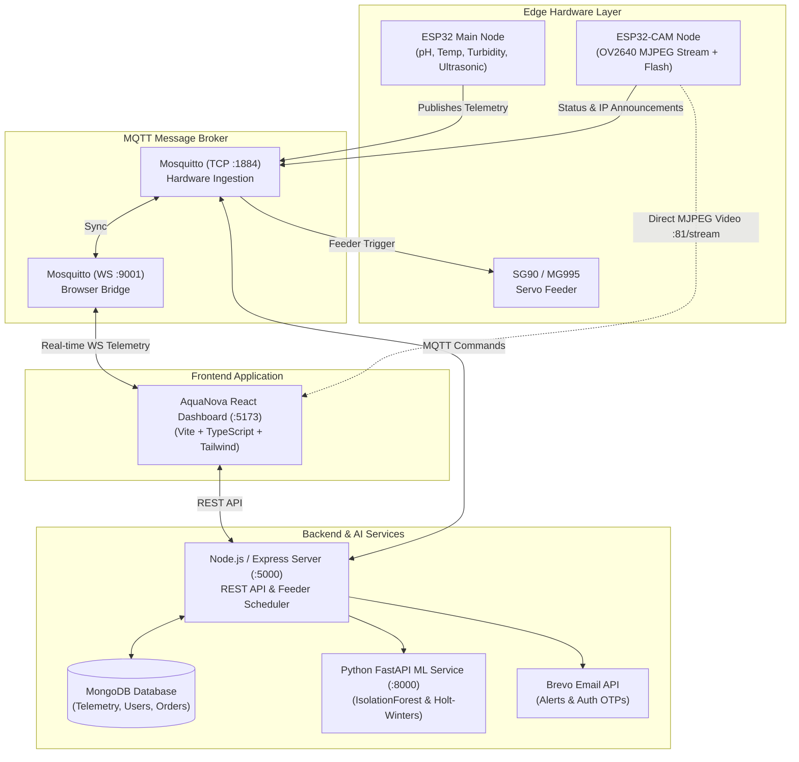

# 🌊 AquaNova — IoT & AI-Powered Smart Aquaculture System

[](https://github.com/Fakruddin-Coder/AquaNova-IOT-AI-For-Smart-Aquaculture)
[](https://opensource.org/licenses/MIT)
[](https://nodejs.org/)
[](https://reactjs.org/)
[](https://www.typescriptlang.org/)
[](https://vitejs.dev/)
[](https://www.mongodb.com/)
[](https://mosquitto.org/)
[](https://www.espressif.com/)
[](https://fastapi.tiangolo.com/)

---

## 📌 Overview

**AquaNova** is an end-to-end, enterprise-grade **Smart Aquaculture Management Ecosystem** engineered to modernize commercial fish farms, shrimp hatcheries, and aquatic research facilities. 

By unifying **multi-sensor IoT telemetry**, **dual-ESP32 edge hardware**, **AI-driven water quality forecasting**, **automated servo-powered feeding schedules**, and **low-latency ESP32-CAM live video surveillance**, AquaNova prevents catastrophic water parameter crashes, optimizes feeding efficiency, and maximizes harvest yield.

---

## ✨ Key Features

- **📡 Real-Time IoT Water Telemetry:** Continuous real-time monitoring of **Water Temperature**, **pH Levels**, **Dissolved Oxygen (DO)**, **Turbidity (NTU)**, and **Water Tank Level (%)**.
- **🤖 Autonomous & Scheduled Feeding:** Automated robotic feeder scheduling with customizable portion weights, feeding intervals, and instant manual override via PWM servo control.
- **📷 AI-Thinker ESP32-CAM Video Stream:** High-framerate MJPEG live video feed, real-time snapshot capture, night-illumination flash control, and remote pan/feed inspection.
- **🧠 AI/ML Anomaly Detection & Forecasting:** FastAPI microservice utilizing **Isolation Forest** algorithms for anomaly detection and **Holt-Winters Exponential Smoothing** for predictive parameter trend forecasting.
- **🚨 Instant Smart Alerts & Notifications:** Threshold triggers automatically notify farmers via **Brevo Email API** (HTML templates) and real-time dashboard notifications.
- **💳 Integrated E-Commerce Store & Razorpay:** Built-in hardware store for IoT telemetry units and automated feeders with **Razorpay payment gateway integration**, order tracking, and receipt generation.
- **👥 Role-Based Access Control (RBAC):** Distinct dashboards for **Administrators** (full telemetry oversight, customer analytics, device provisioning, order management) and **Farmers/Customers** (tank monitoring, feeding controls, device provisioning).
- **🔄 Built-in Hardware Simulator:** Realistic fallback simulation engine for development without physical sensors connected.

---

## 🏗️ System Architecture



---

## 🔌 Hardware & Pinout Specifications

### 1. Main ESP32 Node (Sensors & Feeder)

| Component | Interface | ESP32 GPIO Pin | Operating Voltage | Notes |
|:---|:---|:---|:---|:---|
| **DS18B20 Temp Probe** | 1-Wire Digital | `GPIO 4` | 3.3V / 5V | Requires 4.7kΩ pull-up resistor to 3.3V |
| **Analog pH Probe Module** | Analog ADC1 | `GPIO 34` | 3.3V / 5V | Calibrated standard buffer 4.0 & 7.0 |
| **Turbidity Sensor Module** | Analog ADC1 | `GPIO 35` | 5V | Operational range: 0 - 3000 NTU |
| **Water Level Sensor** | Analog / Ultrasonic | `GPIO 32` | 5V | Real-time tank depth percentage |
| **Feeder Servo (SG90/MG995)** | PWM Signal | `GPIO 13` | **5V VIN** | ⚠️ Connect to 5V rail (not 3.3V) |
| **Status LED Indicator** | Digital Output | `GPIO 2` | Built-in | Heartbeat & connection status indicator |

### 2. AI-Thinker ESP32-CAM Node

| Module Function | Pin / Specification | Notes |
|:---|:---|:---|
| **Camera Sensor** | OV2640 (2 Megapixel) | UXGA, SVGA, VGA, QVGA streaming modes |
| **Live Stream Server** | `http://<ESP32_IP>:81/stream` | Continuous multi-client MJPEG stream |
| **Single Frame Snapshot** | `http://<ESP32_IP>:81/capture` | High-res still frame capture |
| **Night Flashlight LED** | `GPIO 4` (High-power SMD LED) | Controllable via `http://<ESP32_IP>:81/flash?state=toggle` |
| **Programming Boot Pin** | `IO0` to `GND` | Bridge during upload; disconnect to run |
| **Power Supply** | 5V @ 2A Dedicated | Stable rail prevents Wi-Fi brownout resets |

---

## 📁 Repository Structure

```
AquaNova/
├── firmware/                       # Hardware Firmware (Arduino Sketches)
│   ├── aquanova_esp32.ino          # Main IoT Telemetry & Servo Feeder firmware
│   ├── aquanova_esp32_cam/         # AI-Thinker ESP32-CAM video streaming node
│   └── README.md                   # Detailed hardware flashing & wiring guide
├── ml_service/                     # AI/ML Microservice
│   ├── main.py                     # FastAPI service: Anomaly detection & Forecasting
│   └── requirements.txt            # Python dependencies (scikit-learn, statsmodels)
├── server/                         # Backend Application
│   ├── src/
│   │   ├── config/                 # Database and environmental configuration
│   │   ├── controllers/            # Authentication, Orders, and Telemetry controllers
│   │   ├── middleware/             # JWT auth & role validation middleware
│   │   ├── models/                 # Mongoose schemas (User, SensorReading, Order, Tank)
│   │   ├── routes/                 # Express API routes
│   │   ├── services/               # Brevo Email, Feeder Scheduler, Mock Simulator
│   │   └── server.ts               # Express entrypoint
│   └── package.json
├── src/                            # Frontend Single Page Application
│   ├── components/                 # UI components (Feeder, VideoStream, Alerts, etc.)
│   ├── context/                    # React Context (Auth, MQTT, Device State)
│   ├── pages/                      # Dashboard, Monitoring, Admin, Store, Auth
│   ├── services/                   # API client & MQTT client utilities
│   ├── App.tsx                     # Route management & layout wrappers
│   └── main.tsx                    # Vite entry point
├── scripts/                        # Development & testing utilities
│   ├── startMosquitto.js           # Mosquitto broker runner
│   └── publishSensorTest.js        # MQTT test publisher
├── mosquitto.conf                  # Mosquitto Broker configuration (TCP + WS)
├── .env.example                    # Template environment variables
├── .gitignore                      # Git exclusion rules
├── package.json                    # Root build and orchestration scripts
└── vite.config.ts                  # Vite client configuration
```

---

## 🚀 Getting Started

### Prerequisites

Ensure you have the following installed on your machine:
- [Node.js (v18.0.0 or higher)](https://nodejs.org/) & `npm`
- [MongoDB Community Server](https://www.mongodb.com/try/download/community) (Running locally on `mongodb://localhost:27017` or MongoDB Atlas URI)
- [Eclipse Mosquitto MQTT Broker](https://mosquitto.org/download/)
- [Python 3.10+](https://www.python.org/downloads/) *(Optional, for ML service)*
- [Arduino IDE](https://www.arduino.cc/en/software) with ESP32 board support *(Optional, for hardware flashing)*

---

### Step 1: Clone the Repository

```bash
git clone https://github.com/Fakruddin-Coder/AquaNova-IOT-AI-For-Smart-Aquaculture.git
cd AquaNova-IOT-AI-For-Smart-Aquaculture
```

---

### Step 2: Environment Configuration

Create your `.env` file by copying the provided `.env.example`:

```bash
cp .env.example .env
```

Open `.env` in your editor and configure your variables:

```env
# Database & Backend
MONGODB_URI=mongodb://localhost:27017/aquanova
JWT_SECRET=your_super_secret_jwt_key
PORT=5000

# Frontend & MQTT
VITE_API_URL=/api
VITE_MQTT_URL=ws://localhost:9001

# Brevo Email Service (For Real-Time OTPs & Alert Emails)
BREVO_API_KEY=your_brevo_api_key_here
EMAIL_FROM=notifications@yourdomain.com
EMAIL_FROM_NAME="AquaNova Smart Aquaculture"

# Razorpay (Optional - Sandbox enabled by default)
RAZORPAY_KEY_ID=rzp_test_your_key_id
RAZORPAY_KEY_SECRET=your_razorpay_key_secret
```

---

### Step 3: Install Dependencies

Install root and server dependencies:

```bash
# Install frontend & root orchestration dependencies
npm install

# Install backend dependencies
cd server
npm install
cd ..
```

---

### Step 4: Start Mosquitto MQTT Broker

Start the configured Mosquitto broker with both TCP (`1884`) and WebSocket (`9001`) listeners:

```bash
# Using the built-in script
npm run mqtt

# OR directly with Mosquitto executable:
mosquitto -c mosquitto.conf -v
```

---

### Step 5: Launch the AquaNova Application

Run both the Vite frontend development server and Express backend concurrently:

```bash
npm run dev
```

The application will be live at:
- 🌐 **Frontend Client:** [http://localhost:5173](http://localhost:5173)
- ⚙️ **Backend REST API:** [http://localhost:5000](http://localhost:5000)

*(The built-in simulator automatically provisions demo telemetry data if physical sensors are not yet connected!)*

---

### Step 6: (Optional) Run the AI/ML Predictive Microservice

If you wish to run the predictive anomaly and forecasting engine:

```bash
cd ml_service
pip install -r requirements.txt
uvicorn main:app --host 0.0.0.0 --port 8000 --reload
```

---

### Step 7: Flashing ESP32 Edge Hardware

1. Open `firmware/aquanova_esp32.ino` in the **Arduino IDE**.
2. Install required libraries:
   - `PubSubClient` by Nick O'Leary
   - `ArduinoJson` (v6 or v7)
   - `ESP32Servo` by Kevin Harrington
3. Configure your Wi-Fi SSID, Password, and your PC's local IP address in lines 35–41.
4. Select board **ESP32 Dev Module**, choose the COM port, and click **Upload**.
5. Refer to [firmware/README.md](firmware/README.md) for complete wiring diagrams and ESP32-CAM camera setup.

---

## 📡 MQTT Topic Topology

| Topic | Direction | Payload Example / Description |
|:---|:---|:---|
| `aquanova/sensors` | ESP32 ➔ Broker | `{"deviceId":"AN-001","temperature":26.4,"ph":7.4,"dissolvedOxygen":6.8,"turbidity":4.2,"waterLevel":92}` |
| `aquanova/commands/feeder` | Server ➔ ESP32 | `{"action":"FEED","amount":25,"deviceId":"AN-001"}` |
| `aquanova/status/feeder` | ESP32 ➔ Broker | `{"status":"DISPENSED","amount":25,"timestamp":1730452300}` |
| `aquanova/camera/status` | ESP32-CAM ➔ Broker | `{"ip":"192.168.1.150","port":81,"streamUrl":"http://192.168.1.150:81/stream"}` |

---

## 🛡️ Security & Privacy Practices

- **Zero Hardcoded Secrets:** Passwords, API credentials, and JWT secrets are strictly read from environment variables.
- **Git Hygiene:** `.env`, build artifacts (`dist/`, `server/dist/`), `node_modules/`, Python cache files (`__pycache__/`), and local logs are strictly ignored in `.gitignore`.
- **Role Verification:** Critical administrative operations require cryptographically signed JSON Web Tokens (JWT) with verified role checks.

---

## 🤝 Contributing

Contributions, issues, and feature requests are welcome!

1. Fork the project (`https://github.com/Fakruddin-Coder/AquaNova-IOT-AI-For-Smart-Aquaculture/fork`)
2. Create your Feature Branch (`git checkout -b feature/AmazingFeature`)
3. Commit your Changes (`git commit -m 'feat: Add AmazingFeature'`)
4. Push to the Branch (`git push origin feature/AmazingFeature`)
5. Open a Pull Request

---

## 📄 License

Distributed under the **MIT License**. See `LICENSE` for more information.

---

## 👨‍💻 Author & Maintainer

**Fakruddin**
- GitHub: [@Fakruddin-Coder](https://github.com/Fakruddin-Coder)
- Repository: [AquaNova-IOT-AI-For-Smart-Aquaculture](https://github.com/Fakruddin-Coder/AquaNova-IOT-AI-For-Smart-Aquaculture)

*Built with passion for sustainable aquaculture and intelligent IoT automation.* 🌊🐟
